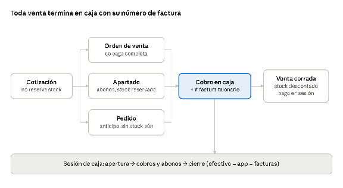

# Sistema Avanza — Especificación
Oct 26, 2026 · @Diego

## Resumen y alcance
El Sistema Avanza es una app web interna para las tres tiendas que maneja inventario, caja, descuentos, cotizaciones, apartados, pedidos y estadísticas. La factura oficial se sigue haciendo a mano en talonario; la app sirve como guía del desglose de cada venta y como control de inventario y efectivo.

**Dentro del alcance**

* Catálogo de productos (importado de Excel, ~718 productos)
* Inventario por tienda, con traslados entre tiendas
* Caja: órdenes de venta, cobro, apertura y cierre con arqueo
* Descuentos con límites por rol y aprobación
* Cotizaciones con validez y conversión a venta
* Apartados con abonos y plazo
* Pedidos de productos que no hay en stock
* Estadísticas de ventas, margen e inventario
* Bitácora de auditoría de acciones sensibles

**Fuera del alcance (por ahora)**

* Emisión de facturas fiscales (requiere autorización de la DGI)
* Pagos con tarjeta integrados
* Tienda en línea para clientes

El documento que genera la app se llama **Orden de venta** y lleva la leyenda "Documento interno – no válido como factura".

## Decisiones pendientes de confirmar
Cada regla de este documento tiene un valor propuesto; cambia la columna "Propuesta" con tu decisión real y Claude ajusta el resto.

| # | Tema | Pregunta | Propuesta |
| :---- | :---- | :---- | :---- |
| 1 | Apartado | Abono mínimo para apartar | 30% del total |
| 2 | Apartado | Plazo máximo para completar el pago | 30 días |
| 3 | Apartado | Si el cliente no completa el pago | Producto vuelve a stock; abono queda como saldo a favor 60 días |
| 4 | Descuentos | Máximo sin aprobación por rol | Vendedor 0%, Cajero 5%, Gerente 15%, Admin sin límite |
| 5 | Descuentos | Precio mayorista para clientes frecuentes | Lista de precio "Mayorista" asignable por cliente |
| 6 | Cotizaciones | Días de validez | 7 días; al vencer se recalcula con precio actual |
| 7 | Devoluciones | Plazo y quién autoriza | 15 días con factura; autoriza Gerente |
| 8 | Moneda | Moneda de precios | Precio base en córdobas; muestra equivalente en USD con tipo de cambio del día |
| 9 | Caja | ¿Se permite vender con stock en cero? | No; se crea un Pedido |
| 10 | Inventario | ¿Costo promedio o último costo? | Costo promedio ponderado |
| 11 | Equipos | Dispositivo de caja por tienda | **Decidido:** una PC por tienda. Sin impresora: la factura se hace a mano en talonario |
| 12 | Internet | ¿La caja debe funcionar sin internet? | Fase 4; fases 1–3 asumen conexión |
| 13 | IVA | ¿Los precios incluyen IVA? | Sí, precios con IVA incluido; se muestra desglosado |

## Roles y permisos
Cinco roles, cada usuario asignado a una o más tiendas; nadie ve ni opera la caja de una tienda que no le corresponde.

| Acción | Vendedor | Cajero | Bodega | Gerente | Admin |
| :---- | :---- | :---- | :---- | :---- | :---- |
| Crear orden de venta / cotización | Sí | Sí | No | Sí | Sí |
| Cobrar y cerrar venta | No | Sí | No | Sí | Sí |
| Abrir y cerrar caja | No | Sí | No | Sí | Sí |
| Aplicar descuento | No | Hasta 5% | No | Hasta 15% | Sin límite |
| Aprobar descuento mayor | No | No | No | Sí (hasta 15%) | Sí |
| Anular venta | No | No | No | Sí, con motivo | Sí, con motivo |
| Recibir mercadería | No | No | Sí | Sí | Sí |
| Ajustar inventario | No | No | Solicita | Aprueba | Sí |
| Trasladar entre tiendas | No | No | Sí | Sí | Sí |
| Cambiar precios y costos | No | No | No | No | Sí |
| Ver costos y márgenes | No | No | No | Sí | Sí |
| Ver estadísticas | No | No | No | Su tienda | Todas |
| Gestionar usuarios | No | No | No | No | Sí |

La aprobación de un gerente se hace con su PIN en la misma pantalla de caja y queda registrada en la bitácora.

## Reglas de negocio
Estas reglas son la fuente de verdad para Claude; los valores marcados como propuesta se ajustan según la tabla de decisiones.

### Ventas y caja
1. Toda venta empieza como **orden de venta** en estado Borrador.
2. El servidor calcula precios, descuentos, IVA y total; el navegador solo muestra.
3. Para cerrar la venta el cajero registra el **número de factura de talonario**. Es obligatorio y no se puede repetir.
4. Al cerrar la venta se descuenta el inventario y el pago queda ligado a la sesión de caja abierta.
5. Formas de pago: efectivo C$, efectivo USD, transferencia, mixto. El tipo de cambio queda guardado en la venta.
6. No se puede cobrar sin una sesión de caja abierta.
7. Cierre de caja: el cajero cuenta efectivo por denominación; el sistema compara efectivo contado, total en la app y suma de facturas del día, y marca diferencias.

### Talonarios
1. Admin registra el rango de facturas asignado a cada caja (ej. 0501–0550).
2. El sistema avisa si un número está fuera de rango, repetido o si quedan números saltados al cerrar el día.
3. Una factura anulada se registra con su número y motivo.

### Descuentos
1. Tipos: porcentaje por línea, porcentaje a toda la orden, monto fijo, y lista de precio Mayorista por cliente.
2. Cada rol tiene un máximo (ver Roles). Arriba del máximo se pide PIN de gerente o admin.
3. Todo descuento guarda quién lo dio, quién lo aprobó y el motivo.
4. El precio final nunca puede quedar por debajo del costo sin aprobación de Admin.

### Cotizaciones
1. Se crean con cliente, productos, precios y fecha de vencimiento (propuesta: 7 días).
2. No reservan inventario.
3. Se pueden convertir en orden de venta, apartado o pedido. Si está vencida, se recalcula con precios actuales.
4. Se pueden compartir por WhatsApp como imagen o PDF.

### Apartados
1. Requieren cliente con nombre y teléfono.
2. Abono mínimo (propuesta: 30%) y plazo máximo (propuesta: 30 días).
3. El producto pasa a **reservado**: no se puede vender a otro cliente.
4. Cada abono se registra como pago en la caja del día.
5. Al completar el pago se convierte en venta y se registra la factura de talonario.
6. Vencido el plazo, el gerente decide: extender, cancelar con saldo a favor, o cancelar con devolución.

### Pedidos
1. Para productos sin stock o que se traen de China.
2. Pueden llevar anticipo. Estados: Solicitado → Ordenado al proveedor → Recibido → Entregado.
3. Al recibir la mercadería, el stock queda reservado para ese cliente.

### Devoluciones
1. Requieren la venta original y autorización de Gerente.
2. El producto vuelve a stock como disponible o como dañado.
3. Se devuelve dinero de la caja o se da saldo a favor.

### Inventario
1. El stock **nunca se edita directamente**: todo es un movimiento (entrada, venta, devolución, traslado, ajuste, reserva).
2. Stock por producto y por tienda, en tres estados: disponible, reservado, dañado.
3. Traslado entre tiendas = salida en una + entrada en otra, confirmada por quien recibe.
4. Los ajustes requieren motivo y aprobación de Gerente.
5. Costo promedio ponderado, recalculado en cada entrada.

## Flujos principales

Una cotización puede convertirse en venta, apartado o pedido; los tres solo se cierran en caja con el número de factura de talonario. El apartado llega a caja al completar el pago y el pedido al recibir la mercadería; cada cobro y abono entra en la sesión de caja del día.

## Esquema de base de datos
Postgres con 21 tablas; todo monto se guarda en centavos como entero (bigint) y toda tabla lleva id (uuid), created_at y created_by.

| Tabla | Para qué | Campos clave |
| :---- | :---- | :---- |
| tiendas | Las tres tiendas | nombre, dirección, activa |
| usuarios | Personal con acceso (id = auth.users.id) | nombre, rol, activo |
| usuario_pines | PIN de aprobación; sin acceso desde el cliente, solo el servidor | usuario_id, pin_hash |
| usuario_tiendas | Qué tiendas ve cada usuario | usuario_id, tienda_id |
| productos | Catálogo | sku, nombre, categoría, marca, precio_centavos, activo |
| producto_costos | Costo de cada producto; solo lo leen Gerente y Admin | producto_id, costo_promedio_centavos |
| listas_precio | Precio normal y mayorista | nombre, producto_id, precio_centavos |
| clientes | Clientes y su historial | nombre, teléfono, tipo (ganadero, minero, taller, otro), lista_precio_id, saldo_favor_centavos |
| movimientos_inventario | Única fuente del stock | producto_id, tienda_id, tipo, cantidad (+/−), estado (disponible, reservado, dañado), referencia_tipo, referencia_id, motivo |
| traslados | Envíos entre tiendas | origen_id, destino_id, estado, enviado_por, recibido_por |
| cotizaciones | Cotizaciones | cliente_id, tienda_id, vence_el, estado, total_centavos |
| ordenes | Ventas, apartados y pedidos | tipo (venta, apartado, pedido), estado, cliente_id, tienda_id, subtotal, descuento, iva, total (centavos), tipo_cambio, factura_numero, vence_el |
| orden_items | Líneas de cada orden | orden_id, producto_id, cantidad, precio_unit_centavos, descuento_centavos, costo_unit_centavos |
| descuentos | Registro de cada descuento | orden_id, item_id, tipo, valor, dado_por, aprobado_por, motivo |
| pagos | Cobros y abonos | orden_id, sesion_caja_id, metodo, moneda, monto_centavos, tipo_cambio |
| sesiones_caja | Apertura y cierre | tienda_id, cajero_id, fondo_inicial, abierta_el, cerrada_el, contado_centavos, esperado_centavos, diferencia_centavos |
| talonarios | Rangos de facturas por caja | tienda_id, desde, hasta, activo |
| facturas_manuales | Números usados o anulados | talonario_id, número, orden_id, estado (usada, anulada), motivo |
| devoluciones | Devoluciones | orden_id, items, motivo, autorizado_por, reembolso_tipo |
| tipo_cambio | Tasa del día | fecha, córdobas_por_usd |
| bitacora | Auditoría | usuario_id, acción, entidad, entidad_id, antes (json), después (json) |

**Vistas calculadas:** stock_actual (suma de movimientos por producto, tienda y estado) y ventas_diarias (para estadísticas).

**Restricciones importantes:** facturas_manuales con número único por talonario; movimientos_inventario y bitacora solo permiten insertar, nunca editar ni borrar.

**Por qué costos y PIN van en tablas aparte:** RLS filtra filas, no columnas. Si el costo viviera en `productos`, cualquier usuario que puede ver el catálogo podría leerlo; lo mismo con `pin_hash` en `usuarios`.

## Estadísticas y reportes
Un panel por tienda y uno consolidado, con filtro por rango de fechas; todos los números salen de las órdenes cerradas y los movimientos de inventario.

| Reporte | Qué responde | Quién lo ve |
| :---- | :---- | :---- |
| Ventas por día, semana y mes | ¿Cómo vamos contra el periodo anterior? | Gerente (su tienda), Admin |
| Ventas por tienda | ¿Qué tienda vende más? | Admin |
| Margen por producto y categoría | ¿Dónde se gana más? | Gerente, Admin |
| Top 20 productos | ¿Qué se vende más, en unidades y en córdobas? | Gerente, Admin |
| Productos sin rotación | ¿Qué lleva 60+ días sin venderse? | Gerente, Admin |
| Stock bajo | ¿Qué hay que reordenar? | Bodega, Gerente, Admin |
| Ventas por tipo de cliente | ¿Cuánto aportan ganaderos, mineros, talleres? | Admin |
| Ticket promedio | ¿Cuánto gasta un cliente por compra? | Gerente, Admin |
| Descuentos dados | ¿Quién da descuentos, cuánto y por qué? | Admin |
| Diferencias de caja | ¿Qué cierres no cuadraron? | Admin |
| Apartados y pedidos abiertos | ¿Qué está pendiente y qué vence pronto? | Cajero, Gerente, Admin |
| Valor del inventario | ¿Cuánto dinero hay en mercadería? | Admin |

Todos los reportes se pueden exportar a Excel/CSV .

## Seguridad y controles antifraude
El riesgo principal es el fraude interno (descuentos inflados, anulaciones, ajustes de inventario), así que los permisos se aplican en la base de datos y cada acción sensible queda registrada.

### Controles en el sistema
* Row Level Security en todas las tablas: cada usuario solo lee y escribe datos de sus tiendas y según su rol.
* Precios, descuentos y totales se recalculan en el servidor; lo que mande el navegador no se acepta.
* Validación de toda entrada con Zod.
* movimientos_inventario, pagos y bitacora son solo de inserción.
* Acciones con PIN de gerente: descuento sobre el límite, anulación, ajuste de inventario, devolución.
* Contraseñas fuertes; 2FA obligatorio para Admin; PIN de 4–6 dígitos para cajeros; cierre de sesión tras 15 minutos sin uso.
* La 2FA de Admin se aplica en la base de datos: una sesión de Admin sin el código (aal1) no tiene permisos de Admin ni ve datos. Si un Admin pierde el teléfono, se borra su factor en Supabase (Authentication → Users → el usuario → MFA) y la configura de nuevo al entrar. Conviene tener al menos dos administradores.
* Secretos solo en variables de entorno; la service_role key de Supabase nunca llega al navegador.
* Respaldo diario automático, con una prueba de restauración al mes.

### Pruebas de seguridad antes de salir a producción
* ☐ Tests automáticos de permisos (ej. cajero no puede dar 20%; usuario de tienda A no ve tienda B)
* ☐ Tests de cálculo de dinero (totales, IVA, descuentos, abonos, cierre de caja)
* ☐ /security-review de Claude Code en cada módulo
* ☐ Semgrep o CodeQL en GitHub
* ☐ Dependabot y npm audit sin vulnerabilidades altas
* ☐ gitleaks: ningún secreto en el repositorio
* ☐ Supabase Security Advisor sin alertas
* ☐ OWASP ZAP contra el ambiente de staging
* ☐ Checklist OWASP ASVS nivel 1
* ☐ Piloto de 2–4 semanas en una tienda, cuadrando caja e inventario físico

## Stack y arquitectura
Next.js + TypeScript en Vercel como app web para PC, con Supabase para base de datos, autenticación y permisos.

| Capa | Herramienta | Notas |
| :---- | :---- | :---- |
| Frontend | Next.js (App Router) + TypeScript + Tailwind + shadcn/ui | Diseñada para PC (pantalla de escritorio, teclado y mouse) |
| Lógica de negocio | Server Actions / API routes de Next.js | Aquí se calculan precios, descuentos y totales |
| Base de datos | Supabase Postgres | RLS en todas las tablas |
| Autenticación | Supabase Auth | Email + contraseña; PIN para cajeros; 2FA para Admin |
| Validación | Zod | Mismos esquemas en cliente y servidor |
| Tests | Vitest (lógica) + Playwright (flujos completos) | Corren en GitHub Actions en cada push |
| Hosting | Vercel (app) + Supabase (datos) | Ambientes separados: staging y producción |
La app es la fuente de verdad del stock y las ventas. **No imprime nada:** la factura oficial se llena a mano en el talonario y la app solo registra su número.

## Diseño visual
Sigue la identidad de Avanza Autopartes (logo y portada de Facebook).

* **Colores:** rojo Avanza `#EA0B1E` para acciones principales y acentos; fondos en gris (`#2A2C30` página, `#313338` paneles, `#393C41` campos); texto blanco y gris claro `#B4B4BC` para lo secundario.
* **Logo:** `public/marca/` (símbolo rojo con la A, texto AVANZA en blanco). Conviene conseguir la versión vectorial (SVG) del diseñador.
* **Tipografía:** Barlow para texto y Barlow Condensed para títulos y montos, cercana a la letra de "Accesorios Premium" de la portada.
* **Uso en caja:** pantallas pensadas para PC, con atajos de teclado para cobrar rápido y montos grandes y legibles.

## Plan de construcción por fases
Cuatro fases; cada una termina con algo usable en tienda y pasa las pruebas de seguridad antes de la siguiente.

1. **Fase 1 — Base y caja (MVP)**
   * Proyecto Next.js + Supabase, staging y producción
   * Usuarios, roles, tiendas, RLS
   * Importar productos de Excel
   * Inventario por movimientos y entrada de mercadería
   * Orden de venta, cobro, número de factura de talonario
   * Apertura y cierre de caja con arqueo
   * **Salida:** piloto en una tienda
2. **Fase 2 — Descuentos, cotizaciones y apartados**
   * Descuentos con límite por rol y PIN de gerente
   * Clientes y lista de precio Mayorista
   * Cotizaciones y envío por WhatsApp
   * Apartados con abonos, reservas y vencimientos
   * Pedidos, devoluciones y traslados entre tiendas
   * Control de talonarios
   * **Salida:** las tres tiendas usando el sistema
3. **Fase 3 — Estadísticas e integraciones**
   * Paneles de estadísticas y exportación a Excel

4. **Fase 4 — Robustez**
   * Modo sin internet en caja con sincronización
   * Auditoría de seguridad formal o pentest
